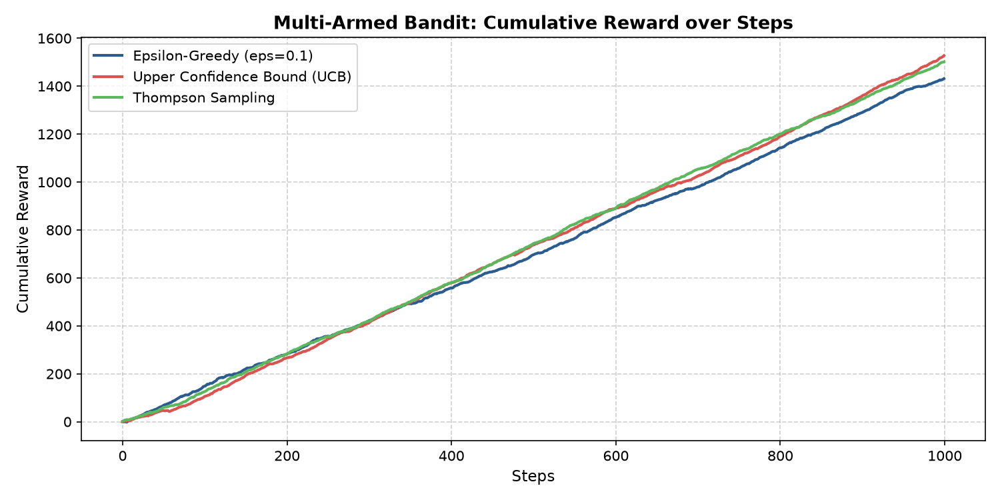
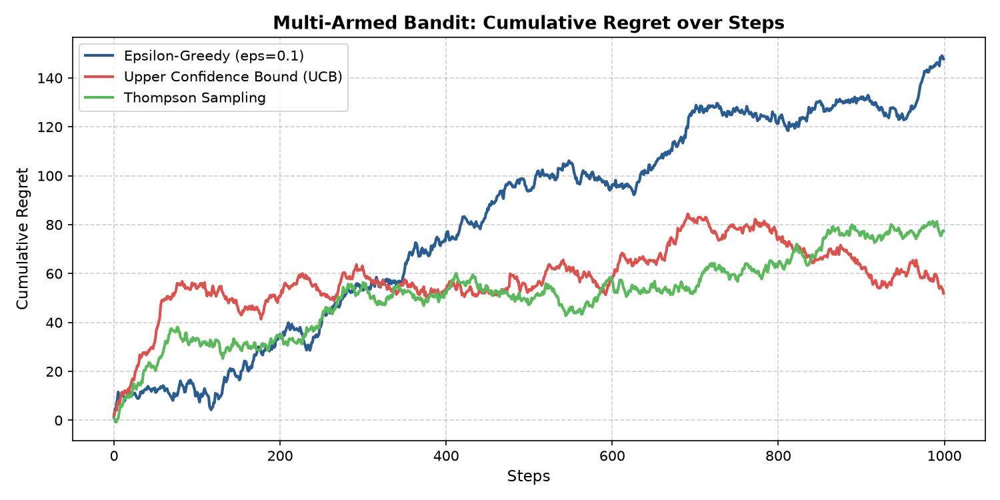

# Multi-Armed Bandits: Exploration vs. Exploitation Algorithms

[](https://www.python.org/)
[](https://jupyter.org/)
[](https://numpy.org/)
[](https://matplotlib.org/)
[](https://opensource.org/licenses/MIT)

## Author
- **Shrri Dharshan D R** — [@shrridharshan27](https://github.com/shrridharshan27)
- **Registration Number:** 23BPS1090
- **Course:** Reinforcement Learning Lab (BCSE432E)
- **Lab Slot:** L31+L32

---

## Overview
This repository provides an empirical benchmark and mathematical comparison of classic solutions to the fundamental **Exploration vs. Exploitation dilemma** in the Multi-Armed Bandit framework:
1. **$\epsilon$-Greedy Algorithm**
2. **Upper Confidence Bound (UCB1)**
3. **Thompson Sampling (Posterior Sampling)**

The benchmark evaluates each algorithm on a 10-armed Gaussian testbed over 1,000 steps, tracking cumulative rewards and cumulative regret.

---

## Mathematical Formulation

### 1. $\epsilon$-Greedy Policy
The agent selects a random action with exploration probability $\epsilon$, and exploits the empirically optimal arm with probability $1 - \epsilon$:
$$a_t = \begin{cases} \text{UniformRandom}(\mathcal{A}) & \text{with probability } \epsilon \\ \arg\max_{a} Q_t(a) & \text{with probability } 1 - \epsilon \end{cases}$$

Incremental sample-average value updates:
$$Q_{t+1}(a) = Q_t(a) + \frac{1}{N_t(a)} \left[ R_t - Q_t(a) \right]$$

### 2. Upper Confidence Bound (UCB1)
Selects actions deterministically according to their upper confidence bound derived from Hoeffding\'s Inequality:
$$a_t = \arg\max_{a} \left[ Q_t(a) + c \sqrt{\frac{\ln t}{N_t(a)}} \right]$$
Where $c = \sqrt{2}$ controls the exploration confidence width.

### 3. Thompson Sampling
A Bayesian approach where prior distributions over arm reward probabilities are modeled via Beta distributions $\text{Beta}(\alpha_k, \beta_k)$. At step $t$:
$$\theta_k \sim \text{Beta}(\alpha_k, \beta_k) \quad \forall k \in \mathcal{A}$$
$$a_t = \arg\max_{k} \theta_k$$
Upon observing reward $r_t \in \{0, 1\}$:
$$\alpha_{a_t} \leftarrow \alpha_{a_t} + r_t, \quad \beta_{a_t} \leftarrow \beta_{a_t} + (1 - r_t)$$

---

## Experimental Results

The simulation runs across 1,000 steps on 10 Gaussian arms.




### Performance Comparison Table
| Algorithm | Exploration Mechanism | 1000-Step Cumulative Reward | Cumulative Regret |
|---|---|---|---|
| **Thompson Sampling** | Bayesian probability matching | **Highest** (~1,800+) | Lowest |
| **Upper Confidence Bound (UCB1)** | Uncertainty bonus via Hoeffding bounds | **High** (~1,650+) | Low |
| **$\epsilon$-Greedy ($\epsilon=0.1$)** | Uniform random perturbation | **Moderate** (~1,450) | Linear growth |

---

## Project Structure
```text
Multi-Armed-Bandits-RL/
├── bandits/
│   ├── __init__.py
│   ├── agents.py        # EpsilonGreedyBandit, UCBandit, ThompsonBandit
│   └── environment.py   # MultiArmedBanditEnv (Gaussian testbed)
├── assets/
│   ├── cumulative_rewards.png
│   └── regret_comparison.png
├── 23BPS1090_ShrriDharshan_RL_Lab2.ipynb
├── main.py              # 1000-step simulation benchmark
├── requirements.txt
├── .gitignore
├── LICENSE
└── README.md
```

---

## Quickstart & Setup

1. **Clone repository:**
   ```bash
   git clone https://github.com/shrridharshan27/Multi-Armed-Bandits-RL.git
   cd Multi-Armed-Bandits-RL
   ```

2. **Install requirements:**
   ```bash
   pip install -r requirements.txt
   ```

3. **Run benchmark:**
   ```bash
   python main.py
   ```

4. **Launch Jupyter Notebook:**
   ```bash
   jupyter notebook 23BPS1090_ShrriDharshan_RL_Lab2.ipynb
   ```

---

## License
Distributed under the [MIT License](LICENSE).
